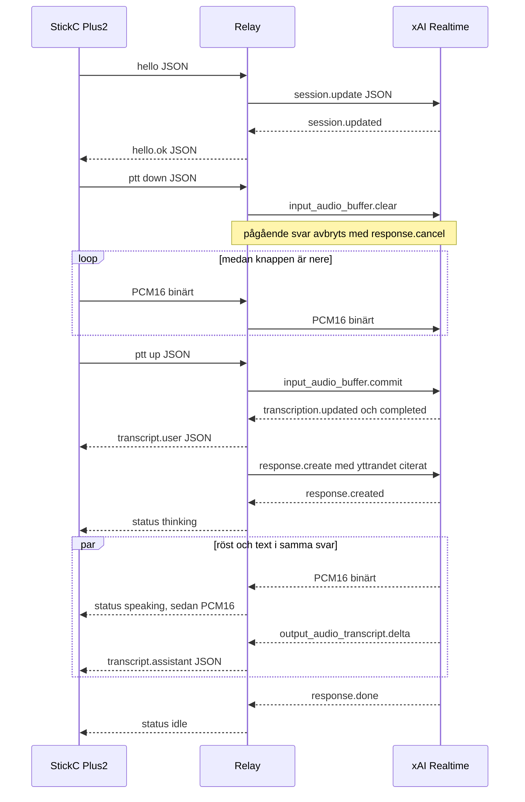
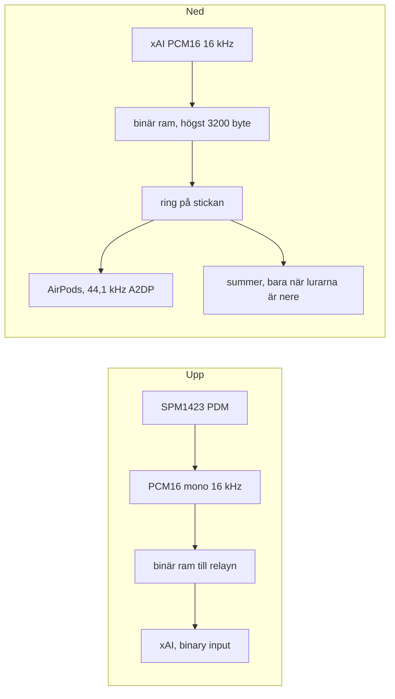
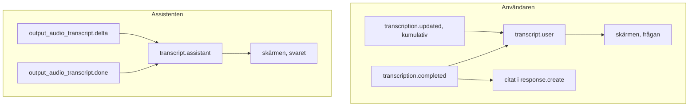

# Kommunikator — design

Hämtat mot docs.x.ai 2026-10-15. Endpoints som inte står i de sidorna finns inte här. Sådant som källan inte slår fast står som TODO.

## Källor

- [Speech to Speech](https://docs.x.ai/developers/model-capabilities/audio/speech-to-speech) (sidan säger last updated 2026-10-13)
- [Voice API reference](https://docs.x.ai/developers/rest-api-reference/inference/voice), avsnittet Realtime
- [Voice overview](https://docs.x.ai/developers/model-capabilities/audio/voice)
- [Ephemeral tokens](https://docs.x.ai/developers/model-capabilities/audio/ephemeral-tokens) — används inte av enheten
- [Speech to Speech model page](https://docs.x.ai/developers/models/realtime-api) — max session 120 minuter
- [StickC-Plus2](https://docs.m5stack.com/en/core/StickC-Plus2)
- [CoreS3-SE](https://docs.m5stack.com/en/core/CoreS3-SE) — samma skärm, mick och högtalare som Lite, ingen GC0308
- [CoreS3 Lite](https://docs.m5stack.com/en/core/CoreS3-Lite) — GC0308, 200 mAh
- [Hat SPK2](https://docs.m5stack.com/en/hat/Hat-SPK2)
- [SPEAKER2.ino](https://github.com/m5stack/M5StickC-Plus/blob/master/examples/Hat/SPEAKER2/SPEAKER2.ino) — I2S-pinnar på Stick-hatten
- M5Unified 0.2.5 sätter Plus2-batteri till ADC på GPIO38 med faktor 2

## Arkitektur

```
M5StickC Plus2                      relay                         xAI
PTT, PDM, skärm, summer  WSS/TLS    FastAPI /ws            WSS    wss://api.x.ai/v1/realtime
enhetstoken                         API-nyckel, tokenkoll          Bearer XAI_API_KEY
PCM16 binärt                        resample, commit/cancel        session.update
```

Enheten pratar bara med relayn. Relayn öppnar xAI-socketen och håller API-nyckeln. Ephemeral tokens är dokumenterade för webbläsare som kopplar direkt till xAI. Den vägen används inte, eftersom nyckeln då skulle behöva en väg ut till enheten.

Relayn körs som Docker på cloud01, i `/home/grok/kommunikator`. Imagen byggs från `./src`. Tjänsten i `docker-compose.yml` heter `kommunikator-relay` och sitter på det externa nätet `proxy`, med `env_file: .env`. Jonas arbetsdator är inte värd. Enheten ansluter till `wss://trek.aldenback.com/ws` (port 443). TLS termineras på proxyn. Processen lyssnar på `0.0.0.0:8090`. Porten styrs av `PORT` i `.env` och är 8090 om variabeln saknas. Firmware litar på ISRG Root X1, så certet ska vara Let's Encrypt eller en kedja som slutar där.

## Flöde

Röst och text går i samma WebSocket, men i olika ramar. Binära ramar är PCM16. Text-ramar är JSON. Relayn översätter xAI:s händelser till enhetens typer och skickar aldrig API-nyckeln nedåt.



### Röst

Mikrofonen och svaret är PCM. Texten styr inte ljudet. xAI hör de binära ramarna. Stickan spelar de binära ramarna som kommer tillbaka, efter att den själv samplat upp till 44,1 kHz för AirPods.



Upp är redan 16 kHz, så relayn kopierar när `XAI_INPUT_RATE` också är 16000. Ned är den takt `hello.playback_rate` bad om. Plus2 ber om 16000. Relayn kopierar den takten och delar upp i ramar under 15 KiB. Första ljudramen kommer först efter `status speaking` för samma tur. Ljud som kommer innan dess, eller efter `response.done`, släpps.

AirPods spelar stereoringen. Summern har en egen mono-kopia som inte spelas medan lurarna är uppe. Den kopian ligger kvar, så samma svar kan höras en gång till i summern när lurarna släpper. Det är en känd bugg.

### Text

Transkriptet är ett sidospår. `grok-transcribe` skriver användarens text. Röstmodellen hör ljudet, och relayn citerar den färdiga texten i `response.create` så svaret gäller det yttrandet. Skärmen visar JSON. Den spelar inte texten.



`transcript.user` är kumulativ: varje rad ersätter frågan. `transcript.assistant` med `cumulative: false` är ett delta och läggs till. Den avslutande assistentraden är hela svaret. `status` är `thinking`, sedan `speaking`, sedan `idle` på `response.done`. UTF-8 behålls i protokollet. Skärmen viker åäö till a och o.

## xAI-session

Anslutning, från guiden och API-referensen:

`wss://api.x.ai/v1/realtime?model=grok-voice-latest&reasoning.effort=none`

- Modell `grok-voice-latest` är alias för `grok-voice-3.0`. `grok-voice-2.0` är deprecated och avvisas av relayn.
- Auth: `Authorization: Bearer <XAI_API_KEY>`. Bara på relayns utgående socket.
- Query-parametern `reasoning.effort` är dokumenterad på handskaket. Default är `high`. Relayn sätter `none` för lägre latens, och samma värde i `session.reasoning.effort`.
- `session.update` skickas direkt efter connect, som i quick start.

Payload som relayn skickar:

| Fält | Värde | Varför |
| --- | --- | --- |
| `voice` | `eve` (env `XAI_VOICE`) | Dokumenterat exempel. Listan hämtas med `GET /v1/tts/voices`. Ingen röst är påhittad. |
| `instructions` | Svenska regler under guidens engelska avsnittsnamn. Primärt svenska, inget norskt eller danskt, engelska bara som inflikade ord, extremt kort, upprepa inte frågan. | Guiden säger att extra språk styrs i instruktionen, och att avsnittsnamnen ska ligga nära träningsformen. |
| `turn_detection.type` | `null` | `input_audio_buffer.commit` finns bara när turn detection är null. PTT är den manuella vägen. |
| `audio.input.format` | `audio/pcm`, 16000 | PCM-takter som dokumentationen listar: 8000, 16000, 22050, 24000, 32000, 44100, 48000. 16000 beskrivs som wideband, bra för tal. |
| `audio.output.format` | `audio/pcm`, enhetens `playback_rate` | Plus2 ber om 16000, så PCM får plats bredvid A2DP. Stickan samplar upp till 44100 lokalt. Relayn samplar inte om när takten redan stämmer. |
| `audio.*.transport` | `binary` | Rå PCM16 little-endian i binära frames. JSON-händelser (transkript, status) stannar text. |
| `resumption.enabled` | `true` | `conversation.created.conversation.id` sparas i relayns minne, hashat per enhetstoken, och skickas som `conversation_id` vid återanslutning. Historiken faller efter 30 minuters inaktivitet. |
| `audio.input.transcription.model` | `grok-transcribe` | Se TODO. Behövs enligt kompatibilitetsnoten för live-transkript av användaren. |
| `audio.input.transcription.language_hint` | `sv` | Svenska saknas i Supported Languages. Hint skickas ändå. Okänd kod ska ignoreras; ett avvisat `session.update` kommer som error. |

Push-to-talk:

1. Knapp ned: enheten strömmar PCM medan knappen är nedtryckt. Relayn skickar binära frames vidare till xAI (`input_audio_buffer.append` behövs inte i binary-läge; råa frames är append).
2. Om ett svar redan spelas skickar relayn `response.cancel`. Det är dokumenterat för manuell avbrytning när VAD är av.
3. Knapp upp: om minst en sample skickats, `input_audio_buffer.commit`. Relayn väntar på den färdiga användartexten (högst 2,5 s) och skickar sedan `response.create` med den texten citerad, så röstmodellen svarar på den frågan och inte på en tidigare. Tomt tryck committas inte. Knapp ned skickar `input_audio_buffer.clear`. Med server VAD hade `response.create` varit automatiskt. Här är det manuellt.
4. Svarsljud kommer som binära frames. Text kommer som JSON.

Latens: enheten väntar inte in hela yttrandet innan den skickar. 20 ms-block (320 samples vid 16 kHz) går upp medan man pratar. Relayn resamplar och skriver vidare utan att buffra ett yttrande.

## Ljudväg

Upp: SPM1423 PDM → PCM16 mono 16 kHz → binär WebSocket-frame.

Relayn resamplar till `XAI_INPUT_RATE` (default 16000). Lika takt är en kopia. Annars linjär interpolation, ett sample latens över chunk-gränsen, så att det inte klickar.

Ned: xAI PCM16 vid den takt enheten anmälde i `hello.playback_rate` (Plus2: 16000) → relayn kopierar när takterna är lika → binär frame. Stickan samplar upp till 44100. AirPods får varje mono-sample som vänster och höger. Summern spelar 16000. Hat SPK2 är av tills knapp B hålls inne. Strömknappen öppnar inställningsskärmen.

Summern är en 1-bitsmodulator. I2S-klockan ligger på 48 kHz, medan `playRaw` får enhetens `playback_rate`, så M5Unified samplar upp. Ringen är 256 KB i PSRAM och släpper bara hela samples. Två ljudbuffertar på 32 ms vardera ligger i kön så en skärmritning inte hinner tysta talet.

Serieporten tar ljudkommandon, en rad per tryck på retur (`pio device monitor -f send_on_enter`). `t` spelar en sekunds ton genom samma väg som svaret. `p` spelar senaste mottagna svaret igen, utan nytt anrop till xAI. `v` sätter volym 0–255, `r` sätter I2S-klockan, `m` sätter förstärkning 1–64. Stickan svarar `ljud v=… klocka=… mag=…`.

Båda takterna måste vara en dokumenterad PCM-takt. 11025 och andra gissningar avvisas.

SPK2 (MAX98357) på Stick-hatten, från M5:s exempel och M5Unified:

| Signal | GPIO |
| --- | --- |
| BCLK | 26 |
| LRCLK | 0 |
| DIN | 25 |

SPM1423, från StickC-Plus2 pin map:

| Signal | GPIO |
| --- | --- |
| CLK | 0 |
| DATA | 34 |

GPIO0 är både mikrofonklocka och högtalarens LRCLK. M5:s egen mic-text säger att mikrofon och högtalare inte kan användas samtidigt. Kommunikatorn är därför halv-duplex, vilket stämmer med PTT: högtalaren stängs innan PDM startar, och tvärtom efter släpp.

Första enheten har ingen Hat SPK2. Firmware startar därför i summer-läge (passiv summer, GPIO2). M5Unified spelar PCM den vägen. Det blir ett surrande tal, inte en högtalare, och transkriptet på skärmen är det läsbara svaret. Chirpen går samma väg. Håll inne knapp B för att växla till SPK2. Valet sparas i NVS den dag hatten sätts på. I SPK2-läge tas chirpen med LEDC på GPIO2, så den inte stjäl GPIO0 från mikrofonen.

Chirp vid tryck är ett stigande pip, vid släpp ett fallande. Det är en TOS-liknande signal, inte ett inspelat ljudeffekt-sample.

M5:s mic-exempel kör SPM1423 i 44100 Hz. 44100 finns i xAI:s PCM-lista. Firmware annonserar faktisk takt i `hello`, och relayn resamplar. TODO om 16 kHz PDM låter dåligt: höj `CAPTURE_HZ` till 44100.

Hat SPK2-sidan säger både "32 kHz till 192 kHz" i punktlistan och "8 kHz ~ 96 kHz" i specifikationen. `playRaw` får `playback_rate` och M5Unified samplar till I2S-klockan. Relayn följer `hello`.

## Enhetsprotokoll

`GET /ws`, uppgraderas till WebSocket.

Auth är bara `Authorization: Bearer <enhetstoken>`. Query `token` accepteras inte. Uvicorn startas med `--no-access-log`, så request-raden med query inte skrivs ut. Relayns egen access-rad är bara sökväg och status, aldrig query eller headers. Firmware sätter headern i varje handskakning och lägger aldrig token i sökvägen. Jämförelsen är `hmac.compare_digest` mot hela listan. Tom lista avvisar alla.

Efter accept:

1. Enheten skickar `{"type":"hello","capture_rate":16000,"playback_rate":16000,"format":"pcm16le","device_id":"stickc-plus2"}`. Plus2 samplar upp svaret till 44100 efter att ramen har tagits emot.
2. Relayn kopplar upp xAI, väntar på `session.updated`, svarar `hello.ok` med takterna och `conversation_id`.
3. `{"type":"ptt","state":"down"|"up"}` ramar in binära PCM-frames.
4. Relayn skickar binär PCM ned, plus JSON:

| type | Innehåll |
| --- | --- |
| `status` | `thinking`, `speaking`, `idle` |
| `transcript.user` | `text`, `final`, `cumulative: true` |
| `transcript.assistant` | `text`, `final`, `cumulative` false på delta |
| `error` | `code`, `message` |
| `pong` | svar på `ping` |

Användarens `updated`-händelse är kumulativ och kommer bara om transkriptionsmodellen är satt. Assistentens `response.output_audio_transcript.delta` är ett delta. `response.done` blir `idle`.

`GET /health` svarar `{"status":"ok"}` utan token. `GET /healthz` är samma svar, kvar som alias.

## Skärm och lägen

ST7789 135×240, liggande (rotation 1), bärnstensfärg på svart. Inbyggda Font2 saknar åäö, så skärmen viker de tecknen till a/o. Protokollet behåller UTF-8. Svaret radbryts under frågan. En triangel nere till höger betyder att fler rader finns.

Lägen: `START`, `PORTAL`, `WIFI`, `KOPPLAR`, `REDO`, `LYSSNAR`, `VANTAR`, `SVARAR`, `FEL`.

Knapp A (GPIO37) är PTT. Knapp B (GPIO39), kort tryck, bläddrar en sida av svaret och går tillbaka till början efter sista sidan. Håll inne B för att växla SPK2/summer. Knapp B intryckt vid start, eller saknat Wi-Fi, öppnar portalen. Knapp C (GPIO35) är väckning/av och används inte som UI.

### CoreS3, CoreS3-SE, CoreS3 Lite

Samma enhetsprotokoll och samma relay. `hello.device_id` är `cores3`. Uppspelning är 24 kHz i den inbyggda AW88298. Mikrofonen är ES7210 via M5Unified, inte Plus2:s PDM. Ingen klassisk Bluetooth, så ingen AirPods-väg. Tal och lyssning turas fortfarande om, eftersom PTT är halv-duplex.

Skärmen är ILI9342, rotation 1, 320×240. Ritytan delas i tre rader och tre kolumner. Texten tar de övre två raderna (3×2). Längst ner tre knappar på 1×1: `PTT`, `INST`, `KAM`. PTT är nedtryckning, inte ett klick. INST öppnar samma inställningslista, utan SPK2 och utan lurar. Ett tryck i texten bläddrar svaret. Strömknappen på sidan gör samma sak som INST, och hålls den inne vid start öppnas portalen.

KAM tar en RGB565-ruta från GC0308 och släpper kameradrivrutinen direkt, så pekskärmen får tillbaka I2C-porten. CoreS3-SE har ingen sensor. Registret `0x00` på adress `0x21` är inte `0x9b`, och rutan visar `INGEN KAMERA`. Ett tryck i bilden tar en ny ruta när sensorn finns.

## Wi-Fi och token

Första start, eller knapp B vid boot, startar SoftAP `Kommunikator`. Formuläret sparar SSID, lösen, relay-värd, port, TLS-flagga och enhetstoken i NVS (`Preferences`, namespace `komm`). `secrets.h` är bara förvalt värde och är gitignorerad. `secrets.h.example` committas.

Produktions-TLS använder ISRG Root X1 (Let's Encrypt), incheckad som publik CA. Annan CA sätts med `KOMM_CA_CERT` i `secrets.h`.

## Ström

Plus2 har ingen AXP192. Efter väckning med knapp C måste HOLD (GPIO4) sättas hög, annars dör enheten. Firmware gör det före `M5.begin()`.

Batteri: `M5.Power.getBatteryVoltage()`. I M5Unified 0.2.5 är Plus2 `pmic_adc` på GPIO38 med ratio 2. Pin mapen kallar GPIO38 "Battery Voltage Detect".

Efter 20 s i `REDO` dimmas bakgrundsbelysningen (GPIO27 ägs av M5GFX). Efter 3 minuter: Wi-Fi ned, `gpio_hold` på GPIO4, light sleep, väckning på knapp A (GPIO37, låg). Sedan HOLD hög igen och ny anslutning.

## Säkerhet

- xAI-nyckeln finns bara i relayns miljö (`XAI_API_KEY`).
- En token per enhet, lista i `DEVICE_TOKENS`.
- Enhet till relay och relay till xAI är TLS (`wss`).
- Relayn vägrar annan värd än `api.x.ai` och annan path än `/v1/realtime`, så nyckeln inte skickas till en gissad URL.
- Ogiltig token stänger med 1008 innan någon xAI-socket öppnas.

## Grok Bot, senare

`POST /v1/missions` tar `{device_id, text, mission_id?}` och kräver enhetstoken. `GrokBotWebhookDispatcher.dispatch` är gränssnittet. Den anropar inget. URL:en är inte publicerad här, och även om `GROK_BOT_WEBHOOK_URL` sätts returnerar routen 501. TODO när CoreIT har adress och payload.

## TODO

1. Svenska (`sv` / `sv-SE`) finns inte i tabellen Supported Languages. Relayn skickar ändå `audio.input.transcription.language_hint = "sv"` tillsammans med svensk `instructions`. Okänd kod ska ignoreras tyst. Om `session.update` svarar med error, ta bort hinten. Bekräfta att talet blir svenska.
2. `audio.input.transcription.model = "grok-transcribe"` står i kompatibilitetsnoten, inte i session-tabellen. Om `session.update` felar på fältet, ta bort det. Då försvinner live-texten av användaren. Färdig användartext kommer ändå på `conversation.item.input_audio_transcription.completed`, men JSON-nyckeln för texten (`transcript` mot annat) är inte utskriven i den hämtade referensen. Relayn läser `transcript`, `delta` och `text`.
3. Felhändelsens typnamn saknas i den renderade referensen (texten ligger direkt efter `response.done`: kod och meddelande, sessionen stannar oftast uppe). Relayn behandlar `type == "error"`. Bekräfta namnet.
4. Formuleringen "null for manual text turns" kan läsas som att null bara gäller text. `input_audio_buffer.commit` säger uttryckligen att commit finns när turn detection-typen är null. Vi skickar `{"type": null}`. Bekräfta mot en riktig session.
5. Röst: `eve` är exempelvärdet. Välj röst efter `GET /v1/tts/voices` om den ska låta mer som en dator.
6. SPK2-takt 16 kHz mot den motstridiga M5-specen. PDM 16 kHz mot M5:s 44100-exempel.
7. `trek.aldenback.com` pekar på cloud01 och TLS sitter på proxyn. Firmware har redan ISRG Root X1. Bekräfta att proxyn skickar `/ws` och `/health` till `kommunikator-relay:8090`.
8. Grok Bot-webhook: adress, auth, payload.
9. Sessionen tar slut efter 120 minuter. Resumption täcker 30 minuters inaktivitet i relayns minne, inte en omstart av containern.
10. Skärmtypsnitt med åäö. Nu vikt till a/o.
11. Bekräfta på hårdvara att `Speaker.end()` släpper GPIO0 innan PDM startar.
